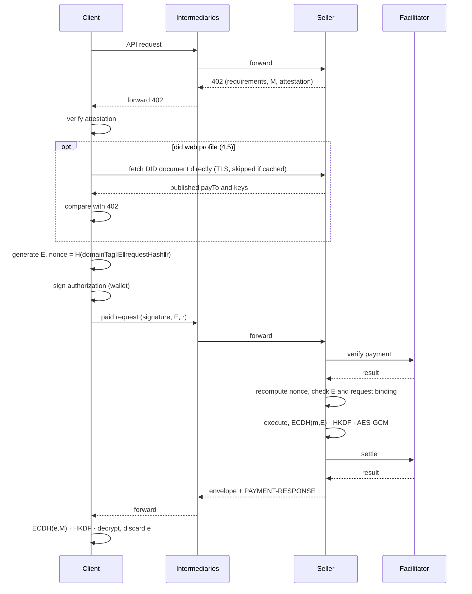

# x402 Response Encryption

- Date: 2026-11-07
- Status: design draft
- Initial scope: EVM sellers and clients using `exact` payments with EIP-3009. The binding is defined independently of the payment scheme (3.1); Permit2 and Solana profiles are defined but not implemented (3.5)
- Purpose: design review, proof of concept, preparation of an x402 extension proposal

> The extension name `response-encryption`, the DID document extension property and fragment rules, and all example fields are proposals. None of this has been adopted into the x402 specification.

## 1. Problem and threat model

### 1.1 Paid data passes through parties that did not pay for it

An x402 response is the thing the client paid for. Between the seller's application and the client it usually crosses several systems that terminate TLS and see it in plaintext:

| Intermediary | Examples |
| --- | --- |
| CDN and edge network | Cloudflare, CloudFront, Fastly |
| Reverse proxy, load balancer | nginx, Envoy, cloud load balancers |
| API gateway | Kong, cloud API gateways |
| Payment or API marketplace | platforms that resell many sellers' APIs behind one domain |
| Agent platform | tool gateways and relays that forward an agent's paid calls |
| Inspection proxy | corporate TLS-inspecting egress proxies |

TLS protects each hop separately. Every system that terminates it can log, cache or retain the body, and so can anyone who compromises it or operates it. Most of these intermediaries are honest. The exposure comes from what they store, not from what they intend.

The content matters as much as the price. Agents increasingly pay per call for data about a specific person: an account balance, a credit report, transaction history, a medical lookup. That response is personal data, and every system on the path can store a copy of it. Encrypting it to the client keeps it out of intermediary logs and caches. The request is not covered (11.8): a question such as "balance of account X" stays visible on the path, so endpoints that carry personal data in the request still expose it.

The goal is that **only the paying client can read a paid response**, whatever sits between it and the seller. "Intermediary" in this document means any system on the path other than the client and the seller's own application, including the ones above.

### 1.2 Threat model

**Passive intermediary.** Sees and stores everything it relays but does not alter messages: request and response logs, caches, crash dumps, a compromised or curious operator. This is the common case. Against it the extension provides full confidentiality of the response body; nothing an intermediary can record lets it decrypt.

**Active intermediary.** Rewrites messages. It can try to swap the client's key, swap the seller's key, alter the request, or strip the extension.

- Swapping the client's key or altering the request is detected by the seller before settlement, because both are committed in the signed payment (3.1).
- Swapping only the seller's key is detected by the client before payment, because the key carries an attestation from the payment address (4.1).
- Stripping the extension yields an error, never plaintext (8).
- The remaining attack is replacing the payment address together with the key, so that the client signs its authorization to the intermediary's address. Plain x402 already permits this (4.3).

**Out of scope.** The seller sees plaintext; this is about the path, not the seller. Request body confidentiality, on-chain payment privacy, payment-delivery atomicity and data quality are not addressed.

### 1.3 Design premises

The scheme does not run ECDH with either party's payment key, for two reasons.

1. Client: most wallets (browser extensions, hardware wallets, MPC, WalletConnect) expose signing APIs and no ECDH. MetaMask's `eth_decrypt` is deprecated. Decrypting with the payment key would only work for agents that hold the private key in memory.
2. Seller: decrypting with the payment key would put the `payTo` private key online on the API server. In practice `payTo` is often a cold wallet, a multisig or a smart account, and a single server compromise would expose both funds and past responses.

The payment signature is used **only to bind keys**. Wallets sign ordinary EIP-712 typed data, the client side gains forward secrecy, and the same mechanism binds the request to the payment.

Encryption happens inside the seller's trust boundary, before the response reaches any intermediary. An edge service that receives plaintext and encrypts on the seller's behalf provides no confidentiality against itself.

The same holds on the client side. The client library generates `e` and decrypts, so whoever runs that code can read the response. A hosted agent runtime that executes the client is part of the client, not an intermediary; the extension protects against platforms that only relay the agent's calls while the client runs elsewhere.

## 2. Design summary

**The client commits a per-request ephemeral public key into a field that the payment signature covers, the `nonce` in the case of EIP-3009. The seller encrypts the response body to that key, using an encryption key that `payTo` has attested.** Both keys hang off a single anchor, the payment signature: an intermediary cannot replace the client's key without invalidating it, and the seller's key is checked against the `to` address the client signs over.

| Item | Choice |
| --- | --- |
| Payment | Existing x402 `exact` scheme, EIP-3009 `transferWithAuthorization` |
| Client receive key | Per-request secp256k1 ephemeral key pair `(e, E)`, generated by the client library rather than the wallet |
| Client key binding | Commitment `c = keccak256(domainTag ‖ E ‖ keyId ‖ requestHash ‖ r)` placed in a signed field of the payment; for EIP-3009, `authorization.nonce = c` |
| Seller encryption key | secp256k1 key pair `(m, M)`, separate from the payment key, held online by the server |
| Seller key binding | EIP-712 attestation signed by `payTo` (EIP-1271 when `payTo` is a contract) |
| Key agreement | `Z = ECDH(e, M) = ECDH(m, E)`, 32-byte x-coordinate of the shared point |
| Key derivation | HKDF-SHA256, salt = EIP-712 digest of the payment authorization |
| Body encryption | AES-256-GCM, 12-byte random IV, 16-byte tag |
| Response policy | Paid success responses for covered resources are always encrypted; no plaintext fallback |
| Initial response format | Single JSON response. Streaming is future work |

### 2.1 Notation

- `‖`: byte concatenation.
- `len(x)`: byte length of `x`, 4-byte big-endian.
- **Domain tag**: a fixed UTF-8 string prepended to hash and KDF inputs so that computations with different purposes cannot collide. Domain tags are not secret. They are unrelated to the 16-byte AES-GCM authentication tag; in this document a bare "tag" always means the GCM tag.

| Domain tag | Used for |
| --- | --- |
| `x402-response-encryption/v1/nonce` | binding commitment `c` (3.1) |
| `x402-response-encryption/v1/request` | requestHash (3.2) |
| `x402-response-encryption/v1/key-id` | keyId (4.1) |
| `x402-response-encryption/v1/response` | HKDF info (6.1) |
| `x402-response-encryption/v1/aad` | AES-GCM AAD (6.3) |

### 2.2 Deployments

This document uses x402's roles. The **client** requests the resource and pays for it. The **resource server** issues the 402, verifies the payment and settles it. The **seller** owns `payTo` and runs the **origin**, the application that produces the response and holds the encryption key `m`. x402's documentation usually treats the resource server as the seller; this extension keeps them apart because a payment gateway can be the resource server in front of a seller's origin. The extension works in two deployments:

| | A. Seller runs x402 | B. Payment gateway runs x402 |
| --- | --- | --- |
| Example | `@x402/express` in the seller's app, behind a CDN or reverse proxy | Cloudflare Monetization Gateway, an API marketplace |
| Issues the 402 and `resource.url` | Origin | Gateway, for its own public URL |
| Verifies and settles | Origin, through a facilitator | Gateway, through a facilitator |
| Checks the binding and encrypts | Origin | Origin |
| What the gateway holds | Nothing | The public 402 info only: key, keyId, attestation |

In B the seller trusts the gateway with payment, as with any payment gateway, but not with the response: the gateway never holds `m` and never sees plaintext. It must relay the paid request to the origin with the payment payload (`PAYMENT-SIGNATURE`), the method and the body unchanged.

The origin cannot tell whether a payment was settled; only the gateway knows. It therefore accepts paid requests **only from the gateway, over an authenticated channel** (mTLS, a gateway-signed token, or the platform's authenticated origin pulls). A valid signature is not proof of payment: anyone can sign an authorization from an unfunded account. On top of that channel the origin checks the payer's signature and the binding itself (5), so a gateway that misroutes a request or swaps a key is caught. A gateway that does not forward the payload breaks the exchange; it cannot make the origin release plaintext.

## 3. Client key binding

### 3.1 Binding commitment

The binding needs one thing from the payment scheme: a value the client chooses that the payment signature covers. The client computes a commitment `c` and puts it there:

```text
c = keccak256(
    "x402-response-encryption/v1/nonce"   // domain tag, UTF-8
    ‖ E                                    // 33-byte compressed public key
    ‖ keyId                                // 32 bytes, the seller key from the 402, verified by the client (4.1)
    ‖ requestHash                          // 32 bytes, see 3.2
    ‖ r                                    // 32 bytes from a CSPRNG
)
```

Where `c` goes is fixed by a scheme profile (3.5). The confidentiality claim rests on this placement: the seller encrypts to whatever `E` it is handed, and the payment signature is the only part of the request an intermediary cannot rewrite. A key sent beside the payment but outside the signature could be replaced with the intermediary's own, and the seller would encrypt the response for the intermediary.

`r` keeps `c` unique even if the same request is sent again with the same ephemeral key. `keyId` is committed so that an intermediary cannot point the seller at another key it still accepts during rotation (4.4), such as an old key whose private part has leaked.

**EIP-3009 profile (normative in v1).** The EIP-3009 `nonce` is an arbitrary `bytes32` included in the signed data, and `authorization.nonce = c`. Token contracts and facilitators only check the nonce for reuse, so choosing its contents does not interfere with existing verification or settlement. [EIP-3009][eip3009] The rest of this document, the reference implementation and the test vectors use this profile, which is why they speak of "the nonce".

The client places `E` and `r` in `PaymentPayload.extensions["response-encryption"]`. The seller computes `requestHash` from the request it actually received, recomputes `c` and compares it with the signed value. On mismatch it rejects **before settlement**.

### 3.2 requestHash

```text
requestHash = SHA-256(
    "x402-response-encryption/v1/request"
    ‖ len(method) ‖ method                 // uppercase
    ‖ len(url) ‖ url                       // canonical resource URL, see 3.3
    ‖ SHA-256(requestBody)                 // hash of the empty string if there is no body
)
```

Headers are left out of the initial version because intermediaries routinely rewrite them. A covered resource must therefore produce its response from the method, URL and body alone: an endpoint whose result depends on a request header (a tenant header, `Accept`, or `Content-Type` choosing a parser) is not protected against an intermediary that changes that header.

`requestBody` is the body bytes after removing any `Content-Encoding`. A seller that cannot decode the request's encoding rejects it before any payment step. Re-serializing JSON or normalizing whitespace counts as a change, so intermediaries that rewrite bodies cannot be used with this extension.

Because the hash is inside the signed nonce, an intermediary that alters the method, URL or body is detected by the seller before settlement. Mixing `requestHash` into the KDF alone would not sign the request; committing it to the nonce does.

### 3.3 URL canonicalization

**Which URL is hashed.** The hash covers `resource.url` as the resource server issued it in the 402 (x402 v2 `ResourceInfo`): the public URL the client pays for. In deployment A that is the seller's own URL. In deployment B it is the gateway's URL (`https://gateway.example/m/abc/v1/report`), even though the gateway relays the request to a different path on the origin.

- Client: canonicalizes `resource.url` from the 402 and refuses to pay (`response_encryption_resource_url_mismatch`) unless it equals the canonical URL the client requested. Otherwise an intermediary could rewrite `resource.url` in the 402 and relay the paid request to that other resource; the hashes would match and the client would pay for something it did not ask for.
- Origin: computes the URL it expects for the route it is serving and canonicalizes it. The query, if any, is part of the URL.
  - In A, and in B when the gateway proxies the seller's own domain without rewriting paths (as Cloudflare Monetization Gateway does), this is the origin's own scheme, host and path.
  - In B when the gateway publishes the API under its own URL (a marketplace), the seller learns that URL when it registers the API and configures it on the origin (`/internal/report` serves `https://gateway.example/m/abc/v1/report`). If the gateway changes the URL without the seller, payments fail with `response_encryption_nonce_mismatch`; nothing is disclosed.

  A URL asserted by the gateway, such as the `aud` claim of a gateway-signed token, can confirm this value but must not replace it: the gateway is an intermediary, and trusting its claim would let it relay a paid request to a different route.

The origin never takes the URL from the payload. Hashing its own expectation is what ties the payment to the resource actually served:

- An intermediary that alters `resource.url` in the 402 makes the client sign over a URL the origin does not expect. The payment is rejected before settlement.
- A gateway that relays a paid request to a different route (the client paid for `/v1/report`, the origin is asked for `/v1/summary`) makes the origin compute a different hash. The payment is rejected before settlement.

**Rules.** These fix a narrowed form of the syntax-based normalization in RFC 3986 §6.2.2. The WHATWG URL parser is not used: its browser-compatibility fixups vary between implementations.

1. Split with the RFC 3986 Appendix B expression. Reject if scheme or authority is missing.
2. Lowercase the scheme. Reject anything other than `https` and `http`.
3. Reject userinfo (`@`). Reject non-ASCII characters in the host; IDNs must already be in A-label (punycode) form.
4. Lowercase the host and strip one trailing `.`. Keep brackets on IPv6 literals.
5. Strip leading zeros from the port. Omit default ports (443 for https, 80 for http) and empty ports. Reject ports above 65535.
6. Reject any path segment that is a percent-encoded dot segment (`%2E`, `%2E%2E`, `.%2E`, ...). Server routers treat these literally while normalization would collapse them, which would let two different routes share a hash.
7. Normalize percent-encoding in the path: decode octets that are unreserved characters (`A–Z a–z 0–9 - . _ ~`) and uppercase the hex digits of the rest. Percent-encode disallowed characters (space, non-ASCII, ...) as UTF-8 octets. Reject a `%` not followed by two hex digits. `%2F` stays encoded.
8. Remove dot segments per RFC 3986 §5.2.4. An empty path becomes `/`. Trailing `/` and repeated `//` are preserved.
9. Split the query on `&` and drop empty pieces. Split each piece at the first `=` into key and value and normalize both as in step 7. `+` is not converted to a space. Keep the pieces in their original order; servers may read parameters by position, so reordering counts as a change. A key without a value (`?flag`) differs from an empty value (`?k=`). Omit `?` if nothing remains.
10. Drop the fragment.

The output is `scheme://host[:port]path[?query]`. The function is idempotent. Appendix A.7 lists 35 examples, including error cases.

URLs with the same canonical form share a `requestHash`, so a covered resource must treat them as the same request. Routing and query parsing must give the same result whether or not the URL has empty query pieces, percent-encoded unreserved characters, a default port or dot segments. Common routers and query parsers behave this way; a handler that reads the raw URL string must canonicalize it first.

### 3.4 What this does not require

- ECDH or decryption APIs in the wallet. The wallet signs EIP-712 typed data as usual.
- That the payer and the data consumer are the same party. Whoever holds the ephemeral key consumes the data; the payment signer authorizes that key. Delegated signers and smart accounts work the same way, provided the facilitator supports EIP-1271.
- Recovering a public key from a signature to decide where to encrypt.

### 3.5 Scheme profiles

A profile for a payment scheme fixes:

- **Extraction:** the client-chosen field, covered by the payment signature, that carries `c`, and a rule that yields exactly one 32-byte value from the payload or rejects it. The rule must not depend on the extension fields, since those are not signed.
- **Digest:** `authorizationDigest`, the digest of what the client signed, used as HKDF salt (6.1) and compared on retries (8.1).
- **Local signature check:** how the seller verifies the client's signature over that digest without the facilitator, which the retry path needs (8.1).
- **Attestation:** for schemes whose payee is not an EVM address, how `payTo` signs the key attestation (4.1).

"The signed commitment" below means the value the extraction rule yields. The seller compares the `c` it recomputes with it (`response_encryption_nonce_mismatch` on difference, a name kept from the EIP-3009 profile), and envelope retention and the per-payment lock (8.1) are keyed by it in every profile. `c` includes the 32-byte random `r`, so it is unique without relying on the scheme's own replay key.

**EIP-3009** (normative, implemented, 3.1). The signed commitment is `authorization.nonce`. `authorizationDigest` is the EIP-712 digest of `TransferWithAuthorization` under the token's domain, and the local check recovers `from` from the signature (EIP-1271 for contract wallets).

The two profiles below follow from the x402 `exact` specifications for [EVM][x402-exact-evm] and [SVM][x402-exact-svm]. They are not implemented and have no test vectors yet.

**Permit2** (`exact` on EVM, `assetTransferMethod: "permit2"`). `c` is `permit2Authorization.nonce`, read as a big-endian `uint256` (the payload carries it as a decimal string). Permit2 accepts any `uint256` as a signature-transfer nonce: it splits the value into a 248-bit word index and an 8-bit bit index of a per-owner bitmap, so distinct values never collide [Permit2][permit2-sig]. x402's Go client already fills this field with 32 random bytes. The witness is not an option: x402's `x402ExactPermit2Proxy` fixes it as `Witness(address to,uint256 validAfter)`. `authorizationDigest` is the EIP-712 digest of `PermitWitnessTransferFrom`, witness included, under the Permit2 domain. The local check recovers `permit2Authorization.from` from that digest, or validates it with EIP-1271 when `from` is a contract, as Permit2 itself does. An invalid signature surfaces as `invalid_permit2_signature`. The attestation is unchanged, since `payTo` is an EVM address.

**Solana** (`exact` on SVM). The client already signs a transaction that must contain an SPL Memo instruction after the `TransferChecked`, holding either `extra.memo` or a random nonce of at least 16 bytes, hex-encoded. In this profile the transaction must contain exactly one top-level SPL Memo instruction, and its data must be exactly 64 lowercase hex characters, the encoding of `c`. The seller rejects a transaction with no such memo or with more than one Memo instruction before execution or settlement. Without this rule a payer could sign one transaction carrying two commitments and present it for two requests. The client's transaction signature covers the whole message, so an intermediary cannot change or add a memo. The SVM spec places the memo after `TransferChecked` in its static layout for standard wallets; this profile requires the memo at the top level also for smart wallets whose transfer happens through CPI. The local check verifies the client's ed25519 signature over the serialized message; it does not need an unexpired blockhash. When `extra.memo` is present the facilitator requires exactly one memo equal to it, which leaves no room for `c`, so a seller must not set `extra.memo` on a covered resource. `authorizationDigest` is SHA-256 of the serialized transaction message the client signed. Two pieces are new work: `payTo` is an ed25519 address and cannot produce the EIP-712 attestation of 4.1, so the profile needs an attestation signed by `payTo` with ed25519 over the same fields. That limits it to a `payTo` controlled by an ed25519 keypair; a program-derived address has no private key, and a seller paid to one needs a delegation mechanism this proposal does not define; and the seller's check of `c` must run after the facilitator's verification, which also validates the client signature. The ephemeral key is generated by the client library, not the wallet, so the secp256k1 suite (6.4) still works; an X25519 suite would only be a convenience.

## 4. Seller key binding

### 4.1 Attestation

The seller generates an encryption key and signs it once with the `payTo` key. This can be done offline; afterwards the `payTo` key does not need to be on the server.

```text
EIP-712 domain: { name: "x402-response-encryption", version: "1", chainId }

EncryptionKeyAttestation {
    address payTo;
    bytes32 keyId;
    bytes   publicKey;     // 33-byte compressed secp256k1
    uint64  notBefore;
    uint64  notAfter;
}
```

Verify with `ecrecover` when `payTo` is an EOA and with EIP-1271 `isValidSignature` when it is a contract, so multisigs and smart-account treasuries can issue attestations.

`keyId` is derived deterministically from the public key:

```text
keyId = keccak256("x402-response-encryption/v1/key-id" ‖ publicKey)   // 33-byte compressed form
```

The client also checks that `attestation.payTo` equals the `payTo` of the payment requirements it is about to sign, so the key belongs to the address the payment goes to. Receivers recompute `keyId` and discard the attestation if it does not match the public key. This rules out one `keyId` naming two different keys and fixes the value for test vectors. Re-attesting the same key with a new validity period keeps the `keyId`; use the valid attestation with the latest `notAfter`.

### 4.2 Delivery

The 402 response carries everything the client needs: `PaymentRequired.extensions["response-encryption"].info` holds the public key, key ID and attestation (7.1). The client verifies the attestation signature before using the key. No other fetch is required.

### 4.3 Trusting `payTo`

An attestation proves that `payTo` approved the key. It does not prove that `payTo` belongs to the seller. An active intermediary can replace the `payTo`, public key and attestation in the 402 response **with a consistent set of its own**; the client would then pay the intermediary and receive a response the intermediary can read.

This is the trust model x402 already has. Without this extension, an intermediary that rewrites `payTo` in the 402 takes the payment and can forward or keep the plaintext response. The extension adds no new attack: **to read a response, an active intermediary must get the client to sign its payment to an address the intermediary controls**, and a passive one cannot read it at all. It cannot swap only the encryption key, because the attestation ties the key to `payTo`, and it cannot swap the client's key, because that is committed in the signed nonce (3.1).

This does not necessarily leave public evidence. The intermediary can settle the authorization and keep the payment, which puts a transfer to a foreign address on-chain. It can also leave the authorization unsettled, buy the same response from the seller with its own receive key, and re-encrypt it to the client; nothing on-chain then differs from an ordinary purchase. Preventing substitution needs a trust anchor for `payTo` that the intermediary cannot change: a `payTo` the client pinned in advance, or the did:web profile against intermediaries that cannot serve the seller's domain (4.5).

Knowing before payment that `payTo` belongs to the intended seller is a problem for x402 as a whole, not for this extension. Clients that need it can pin `payTo` per seller in configuration, or use the optional profile in 4.5.

### 4.4 Key rotation

Because the 402 response always carries the current key, rotation needs no coordination with clients. The only window to manage is between a client reading a 402 and the seller receiving the paid request.

**Seller**

1. Generate the new key pair and have `payTo` sign its attestation.
2. Start advertising the new key in 402 responses. Advertise one key at a time.
3. Keep accepting the old `keyId` for a **grace period** of at least the longest `validBefore - validAfter` window the seller issues in its payment requirements (`maxTimeoutSeconds`), so payments signed against a 402 just before the switch still settle. Ten minutes is a reasonable default.
4. After the grace period, stop accepting the old `keyId` and delete its private key. Deleting it is what bounds the seller-side exposure in 9: recorded responses for that key can no longer be decrypted by anyone.

A payload naming a `keyId` outside the accepted set gets `response_encryption_unknown_key_id` before settlement, with the current key in the fresh `PaymentRequired` (7.4).

**Validity and re-attestation.** Rotate at least every 90 days, and set `notAfter` no later than the planned rotation plus the grace period. Re-attesting the same key with a later `notAfter` keeps its `keyId` (4.1) and is not a rotation.

**Client.** A client may reuse a verified 402 key while its attestation is valid, but should take the key from each new 402. On `response_encryption_unknown_key_id` it verifies the key in the error response as in 4.1 and signs a new authorization with a new nonce, `E` and `r`. It retries once; a second rejection is a hard failure. No funds move on either attempt, since the rejection happens before settlement.

**Compromise.** If `m` leaks, the seller stops accepting its `keyId` at once, without a grace period. Core has no revocation list: until `notAfter`, a party holding the leaked key and the old attestation could present them in a 402. It still cannot redirect payment, because `payTo` is unchanged, and the seller rejects payloads naming the dropped key, so no new responses are encrypted to it. Short `notAfter` values limit how long a leaked attestation stays presentable. Under the did:web profile, removing the key from `keyAgreement` revokes it immediately for clients that check (4.5).

**did:web profile.** Publish the new key in the DID document **before** advertising it in 402 responses, otherwise checking clients reject it with `response_encryption_did_key_not_found`. Remove the old key from `keyAgreement` after the grace period.

### 4.5 Optional profile: did:web public reference

This profile lets a client compare the 402 values with a reference the seller publishes on its own domain. It is optional. Implementations of the core extension do not need it, and nothing in sections 3, 6 or 7 depends on it.

The reference is a `did:web` DID document, the same mechanism the x402 `offer-and-receipt` extension uses to publish signing keys. No new `.well-known` path is defined, so no IANA registration is needed, and the existing `did:web` resolver in the x402 SDK applies. [x402 Offer & Receipt][x402-offer-receipt], [did:web][did-web]

**Location.** `did:web` expresses several sellers under one domain through the path.

| DID | Document URL | Use |
| --- | --- | --- |
| `did:web:api.seller.example` | `https://api.seller.example/.well-known/did.json` | Seller with its own domain |
| `did:web:platform.example:sellerA` | `https://platform.example/sellerA/did.json` | Seller hosted under a platform domain |

**Contents.** The encryption key goes in `keyAgreement`; `payTo` is a `blockchainAccountId` (CAIP-10). The attestation sits next to the key as an extension property of its verification method.

```json
{
  "@context": ["https://www.w3.org/ns/did/v1", "https://w3id.org/security/suites/jws-2020/v1"],
  "id": "did:web:api.seller.example",
  "verificationMethod": [
    {
      "id": "did:web:api.seller.example#payto-eip155-84532",
      "type": "EcdsaSecp256k1RecoveryMethod2020",
      "controller": "did:web:api.seller.example",
      "blockchainAccountId": "eip155:84532:0x…payTo"
    },
    {
      "id": "did:web:api.seller.example#x402-re-<keyId, 64 hex>",
      "type": "JsonWebKey2020",
      "controller": "did:web:api.seller.example",
      "publicKeyJwk": { "kty": "EC", "crv": "secp256k1", "x": "…", "y": "…" },
      "x402ResponseEncryption": {
        "keyId": "0x…", "payTo": "0x…", "notBefore": 1793836800, "notAfter": 1825372800, "signature": "0x…"
      }
    }
  ],
  "keyAgreement": ["did:web:api.seller.example#x402-re-<keyId, 64 hex>"]
}
```

- The encryption key's fragment is `x402-re-` followed by the 64 hex digits of `keyId`.
- The `payTo` fragment is `payto-` followed by the CAIP-2 network with `:` replaced by `-`, since `payTo` may differ per network.
- To rotate, add a new method and remove expired ones. A key no longer listed in `keyAgreement` is treated as revoked.

A complete generated example is in `test-vectors/did-document.json`.

A seller using the profile adds `kid`, the DID URL of its key, to the 402 info (7.1).

**Client checks**, after the core checks pass:

1. Take the DID from `kid` and check it against the URL the client requested. The DID's host (port encoded as `%3A`) must equal the request host. If the DID has a path, the request path must start with `/<path>/`.
2. Fetch the DID document directly from that origin over TLS, cached under normal HTTP caching rules.
3. Check that `kid` is listed in `keyAgreement`, that its JWK equals the 402 public key, and that the `blockchainAccountId` for the payment network equals the attestation's `payTo`.

Any failure means no payment.

The DID document binds the key and `payTo` to the **domain**; the attestation binds the key to the **payment address**. The profile is therefore only as strong as control of the domain's responses. It stops intermediaries that cannot serve content for the seller's domain, such as a marketplace under its own domain or an agent platform. It does not stop a party that can: the seller's web server if compromised, the CDN that terminates TLS for the domain, or a TLS-inspecting proxy the client trusts. Such a party can publish its own `payTo` and key in the DID document together with an attestation it signed itself. Against those, only a `payTo` the client obtained out of band helps (4.3).

**Limits.** The anchor is the seller's domain and TLS. The profile does not help against an active intermediary that terminates TLS for the seller's domain (a CDN in front of it can serve a forged DID document), or when the client only knows a marketplace URL. Letting a seller authorize such origins in its DID document is an open item (11.4).

## 5. Message flow

| Step | Action |
| --- | --- |
| 1. Initial request | The client calls the paid API. |
| 2. 402 response | The seller returns payment requirements and `response-encryption` info (required flag, suite, public key, key ID, attestation, and `kid` under the did:web profile). |
| 3. Key check | The client checks keyId, the attestation signature, the validity period, and that the attested `payTo` is the `payTo` it will pay. Under the did:web profile it also compares `payTo` and the key with the DID document; with pinned configuration it compares `payTo` with the pinned value. On failure it does not pay. |
| 4. Paid request | The client generates `(e, E)` and `r`, computes `requestHash`, builds the nonce and signs the authorization. It resends the request with `E`, `r` and `keyId` in the extension. |
| 5. Payment check | The seller verifies the payment through the facilitator, then recomputes the nonce to confirm that `E` and the request are bound to the signature. On failure it does not settle and returns an error. |
| 6. Execute and encrypt | The seller runs the request and encrypts the body as in section 6. |
| 7. Settle and deliver | The seller settles according to the scheme and returns the envelope with `PAYMENT-RESPONSE`. |
| 8. Decrypt | The client re-derives the key from its stored `e`, the original request and the authorization, verifies the tag and decrypts. It then discards `e`. |

In deployment B (2.2) the gateway performs steps 2, 7 and the facilitator check in step 5, and relays the paid request to the origin. The origin accepts the request only from the authenticated gateway (2.2). It does not rely on the payload's own `accepted` fields: it recovers the signer of the authorization under the token domain it is configured to accept and checks that it is `from` and that `value` covers the price. For a new execution it also checks that the authorization is within `validAfter` and `validBefore` and that `to` is the `payTo` that attested the selected `keyId`. It then checks the binding and encrypts (steps 5 and 6). The diagram shows deployment A.



## 6. Cryptographic construction

### 6.1 Key derivation

```text
Z    = x-coordinate( e·M ) = x-coordinate( m·E )      // 32 bytes, big-endian

salt = authorizationDigest                            // digest the client signed, fixed by the profile (3.5), 32 bytes

info = "x402-response-encryption/v1/response"
       ‖ E                                            // 33 bytes
       ‖ M                                            // 33 bytes
       ‖ keyId                                        // 32 bytes
       ‖ len(caip2Network) ‖ caip2Network             // UTF-8, e.g. "eip155:8453"
       ‖ requestHash                                  // 32 bytes

K    = HKDF-SHA256(IKM = Z, salt, info, L = 32)
```

Only the x-coordinate of the shared point is used. Libraries differ in their default ECDH output (33-byte compressed point, hashed or not), so implementations must produce this form explicitly. Peer public keys must be checked to be on the curve and not the point at infinity. [RFC 5869][rfc5869]

The client rebuilds `info` and `salt` from the request it sent and the authorization it signed, never from values carried in the response.

### 6.2 IV

`E` and the authorization digest differ for every payment, so **every payment gets its own AES key**, and each `K` encrypts exactly one response. A 12-byte IV from a CSPRNG is sufficient; no cross-server IV coordination or counters are needed.

One rule still applies: if the response for a payment has to be produced again, **resend the stored envelope instead of encrypting again**. This removes any path that encrypts a second plaintext under the same `K`. [RFC 5116][rfc5116], [NIST SP 800-38D][nist-gcm]

### 6.3 AAD

```text
AAD = "x402-response-encryption/v1/aad"
      ‖ version (1 byte)
      ‖ keyId
      ‖ uint16(httpStatus)
      ‖ len(contentType) ‖ contentType
```

This authenticates the original status code and content type. AAD is not encrypted, so nothing confidential goes in it.

### 6.4 Suites

The `suite` field names the curve, KDF and AEAD together. Version 1 defines one suite, `secp256k1-hkdf-sha256-aes256gcm`. secp256k1 is the curve EVM wallets and their libraries already implement, so a client or seller adds no new elliptic-curve dependency, and the encryption key is managed with the same tooling as `payTo`.

Nothing in the construction depends on that curve. Any Diffie-Hellman group can be added as a new suite, for example X25519 for clients in ed25519 ecosystems such as Solana, P-256 for keys held in WebCrypto, HSMs or secure enclaves, or an HPKE ciphersuite (RFC 9180) so implementations can use HPKE libraries directly. A suite definition fixes:

- the public key encoding and its length, used for `publicKey`, `ephemeralPublicKey` and as the input to `keyId` (4.1);
- the shared secret `Z` (6.1), such as the x-coordinate for secp256k1 or the X25519 output, and the point validation the receiver performs;
- the KDF and AEAD, with their key and IV sizes.

The commitment (3.1) fixes `E` at the suite's fixed length, so the commitment stays unambiguous. A seller may advertise several suites in a later version; v1 keeps one to limit the review surface.

## 7. Extension and message formats

### 7.1 402 response

```json
{
  "extensions": {
    "response-encryption": {
      "info": {
        "version": 1,
        "required": true,
        "suite": "secp256k1-hkdf-sha256-aes256gcm",
        "keyId": "0x…32bytes",
        "kid": "did:web:api.seller.example#x402-re-…64hex",   // optional, did:web profile (4.5)
        "publicKey": "0x02…33bytes",
        "attestation": {
          "payTo": "0x…",
          "notBefore": 1793836800,
          "notAfter": 1825372800,
          "signature": "0x…"
        }
      },
      "schema": { "…": "schemas/payment-required-info.schema.json" }
    }
  }
}
```

### 7.2 PaymentPayload

Following the x402 extension convention, the client echoes the advertised `info` unchanged and adds its own fields. When the 402 is a rejection (7.4), the client drops `errorReason` and `errorMessage` before echoing. resource servers reject a payload whose extension info does not contain every advertised field (`extension_echo_mismatch`).

```json
{
  "extensions": {
    "response-encryption": {
      "info": {
        "version": 1,
        "required": true,
        "suite": "secp256k1-hkdf-sha256-aes256gcm",
        "keyId": "0x…32bytes",
        "publicKey": "0x02…33bytes",
        "attestation": { "payTo": "0x…", "notBefore": 1793836800, "notAfter": 1825372800, "signature": "0x…" },
        "ephemeralPublicKey": "0x03…33bytes",
        "nonceSalt": "0x…32bytes"
      }
    }
  }
}
```

`nonceSalt` is `r` from 3.1. These fields are not signed themselves, but the seller recomputes the nonce, so replacing any of them fails verification.

The server registers `keyId`, `publicKey`, `attestation`, `kid`, `ephemeralPublicKey` and `nonceSalt` as dynamic info fields, which x402 leaves out of the echo comparison. Otherwise a payload signed against the 402 issued just before a rotation would fail the echo check before the grace period in 4.4 applies.

### 7.3 Success envelope

The envelope is sent with HTTP status 200 and content type `application/x402-encrypted+json`. The resource's own 2xx status is carried in `status` and authenticated by the AAD (6.3), and the client restores it after decryption. This keeps a body on the wire for statuses that have none, such as 204. HEAD requests cannot carry an envelope and are not covered: the server rejects a paid HEAD request before settlement.

```json
{
  "version": 1,
  "keyId": "0x…32bytes",
  "status": 200,
  "contentType": "application/json",
  "iv": "<base64url, 12 bytes>",
  "ciphertext": "<base64url, ciphertext ‖ tag>"
}
```

The tag is appended to the ciphertext, the default layout of most AEAD libraries. Base64url is unpadded. The HTTP response's own content type is `application/x402-encrypted+json` (proposed name).

### 7.4 Errors

Codes follow the x402 convention of snake_case reasons, all prefixed `response_encryption_`. As in the core specification, clients match on the code and never on message text.

**Resource server, before settlement.** The server does not settle and responds with HTTP 402 and a fresh `PaymentRequired`. Its `error` field carries a human-readable message, and `extensions["response-encryption"].info` carries the current key information plus `errorReason` and an optional `errorMessage`, so the client can retry immediately (for example after a key rotation).

| `errorReason` | Condition | Section |
| --- | --- | --- |
| `response_encryption_extension_missing` | Covered resource, but the payload has no `response-encryption` info | 8 |
| `response_encryption_unsupported_version` | Payload `version` not implemented | 7.2 |
| `response_encryption_unknown_key_id` | `keyId` not held by the server (rotated out, or never issued) | 4.1 |
| `response_encryption_invalid_ephemeral_key` | `ephemeralPublicKey` not a valid compressed secp256k1 point | 6.1 |
| `response_encryption_invalid_url` | The server cannot canonicalize the URL it received (3.3) | 3.3 |
| `response_encryption_nonce_mismatch` | Recomputed `c` differs from the signed commitment (`authorization.nonce` in EIP-3009) | 3.1, 3.5 |

An invalid payment signature is reported with the existing scheme code (`invalid_exact_evm_payload_signature` for EIP-3009 `exact`). The nonce check runs only after the signature check passes, so a nonce rewritten to match a swapped key surfaces as a signature error (A.6).

**Resource server, encryption failure.** If encryption fails, the server does not settle where the flow still allows it and responds with HTTP 500 and a JSON body containing only `errorReason: "response_encryption_encryption_failed"`. It never returns the resource body (section 8).

**Client, local.** These codes never go on the wire. They are defined so that client libraries and test vectors name failures the same way.

| Code | Condition | Section |
| --- | --- | --- |
| `response_encryption_unsupported_version` | 402 `version` not implemented | 7.1 |
| `response_encryption_unsupported_suite` | 402 `suite` not implemented | 7.1 |
| `response_encryption_invalid_public_key` | 402 `publicKey` not a valid compressed point | 4.1 |
| `response_encryption_key_id_mismatch` | `keyId` does not match the public key | 4.1 |
| `response_encryption_attestation_invalid` | Attestation signer is not `attestation.payTo` | 4.1 |
| `response_encryption_did_origin_mismatch` | `kid` DID does not cover the requested URL | 4.5 |
| `response_encryption_did_key_not_found` | `kid` not in the DID document's `keyAgreement`, or its fragment does not match `keyId` | 4.5 |
| `response_encryption_did_key_mismatch` | DID document JWK differs from the 402 public key | 4.5 |
| `response_encryption_did_pay_to_mismatch` | DID document does not list `attestation.payTo` for the network | 4.5 |
| `response_encryption_attestation_expired` | Current time outside `notBefore`..`notAfter` | 4.1 |
| `response_encryption_pay_to_mismatch` | `attestation.payTo` differs from the payment requirements' `payTo`, or from a pinned `payTo` | 4.1, 4.3 |
| `response_encryption_resource_url_mismatch` | The 402's `resource.url` is not the URL the client requested | 3.3 |
| `response_encryption_decrypt_failed` | AES-GCM authentication failed | 6 |

The four `did_*` codes belong to the did:web profile and are used only by clients that implement it.

URL canonicalization (3.3) reports its own sub-reasons (`url_not_absolute`, `url_encoded_dot_segment`, ...) for logs and tests; on the wire they all map to `response_encryption_invalid_url`.

JSON Schemas for all four message bodies are in `schemas/` (Appendix A.8).

## 8. Mandatory encryption

**Paid success responses for covered resources are always encrypted.**

"Encrypt if the extension is present, otherwise send plaintext" is not allowed. An intermediary that strips the extension would receive plaintext, and a client rejecting it afterwards cannot take the exposed body back.

- A missing extension, missing `E` or `r`, a nonce mismatch, or an unknown key ID is an error **before settlement**.
- Error responses never carry the resource body.
- If encryption fails, plaintext is still not returned (8.1).

Receive-key checks finish in the same step as payment verification, so almost no key-related failure can happen after settlement.

### 8.1 Retries and envelope retention

If the response is lost after settlement (a dropped connection, an intermediary timeout), the client has paid and has nothing to decrypt. It must not sign a new authorization, which would pay a second time. It resends the **identical** paid request instead, and the seller returns the envelope it already produced.

**Seller**

- After settlement succeeds, store the envelope keyed by the signed commitment (3.5), the authorization `nonce` in the EIP-3009 profile, together with the authorization digest (6.1), for a retention period. 24 hours is the recommended minimum.
- On a paid request, look up the signed commitment before contacting the facilitator. If an envelope is stored, require the presented authorization to have the stored digest, verify the client's signature locally as the profile defines (3.5) and recompute `c` (3.1) as usual, then return the stored envelope byte for byte. The commitment alone is not enough: its inputs are public, so anyone can sign a different authorization carrying the same value. Do not call the facilitator, settle, or run the request again.
- The `keyId` check and the authorization's validity window are skipped for a stored envelope: the key may have been rotated out since settlement (4.4), and the window may have closed while the client was retrying. The stored envelope does not need the private key.
- Serialize processing per signed commitment, taking the lock before the lookup and holding it until the envelope is stored, so a duplicate that arrives while the first request is still running waits for it instead of running the request twice. Sellers with several workers need a shared lock. The scheme's own replay protection stops a second settlement (in EIP-3009 the token contract rejects a used nonce); the lock prevents double execution.
- Recomputing `c` is what stops a replayed payload from being used for a different request: changing the method, URL or body changes `requestHash`, and the request is rejected with `response_encryption_nonce_mismatch` instead of receiving the stored envelope.

Returning a stored envelope to whoever presents the payload discloses nothing new. It is ciphertext that already passed through every intermediary on the first attempt, and only the holder of `e` can decrypt it.

**Client.** Keep `e`, `r`, the signed authorization and the original request until decryption succeeds or the retention period ends. Retry with the same payload. After the retention period the seller no longer holds the envelope; the payment scheme then reports the nonce as already used, and recovery is a matter of payment policy.

**Order of encryption and settlement.** In the flow of section 5 the seller encrypts before it settles, so an encryption failure normally happens before any funds move: the seller does not settle and returns HTTP 500 with `response_encryption_encryption_failed`. Schemes or deployments that settle first still must not fall back to plaintext.

## 9. Security properties

| Property | Status |
| --- | --- |
| Body confidentiality against passive intermediaries | Provided |
| Body confidentiality against active intermediaries | Provided unless the intermediary also substitutes `payTo` and gets the client to sign its payment to that address, which plain x402 already permits (4.3). A pinned `payTo` prevents it before payment; the did:web profile prevents it for intermediaries that cannot serve the seller's domain (4.5) |
| Binding between payment and receive key | Provided. `E` is committed in the signed nonce |
| Binding between request and payment | Provided. `requestHash` is committed in the signed nonce and checked by the seller before settlement |
| Response tamper detection | Provided. AES-GCM tag and AAD |
| Response origin authentication | Implicit, to the client only. Only the holder of `M`'s private key can derive `K`. Not provable to third parties |
| Client-side forward secrecy | Provided. `e` is discarded after decryption; a leaked payment key does not expose past responses |
| Seller-side forward secrecy | Not provided. A leaked `m` decrypts recorded past responses. Short `notAfter` and rotation bound the exposure |
| Seller access to plaintext | The seller sees the plaintext |
| On-chain payment privacy, request body confidentiality | Out of scope |
| Atomicity of payment and delivery, data quality, refunds | Out of scope |

A leaked `m` lets an attacker read responses but not move the seller's funds, because the encryption key and payment key are separate.

Seller-side forward secrecy would need the seller to use a per-response ephemeral key and sign the envelope, with the signing key also bound by a `payTo` attestation. That is left for later. The construction resembles HPKE Auth mode, but secp256k1 is not in the HPKE KEM registry, so it is not called HPKE. [RFC 9180][rfc9180]

## 10. Proof of concept

### 10.1 What was built

| Component | Path |
| --- | --- |
| Primitives: URL canonicalization, nonce binding, attestation, envelope | `packages/core` |
| Client `fetch` wrapper: key check, EIP-3009 signing with the binding nonce, decryption, plaintext refusal | `packages/fetch` |
| Seller middleware on `@x402/express` (deployment A), origin middleware behind a gateway (deployment B), envelope storage | `packages/express` |
| Test vectors and an independent Python verifier sharing no code with the generator | `test-vectors` |
| Base Sepolia demo through a logging reverse proxy | `examples/base-sepolia` |

Scope: EIP-3009 `exact` on Base Sepolia, EOA `payTo`, single JSON responses. The did:web profile is covered by test vectors (DID document and its cases) but the client wrapper does not resolve DID documents.

### 10.2 Results

The end-to-end tests run the real `@x402/express` middleware with an in-process facilitator that checks EIP-3009 signatures and used nonces. Deployment A runs behind a logging reverse proxy. Deployment B runs behind a gateway that issues the 402 for its own URL and relays to the origin under a different path.

| Scenario | Result | Where |
| --- | --- | --- |
| Normal payment | Decrypted body equals the original; no plaintext in the intermediary log | A, B, Base Sepolia |
| Intermediary replaces `ephemeralPublicKey` | Rejected before settlement, `nonce_mismatch` | A, B, A.6 |
| Intermediary points the payload at another key the seller still accepts | Rejected before settlement, `nonce_mismatch` | A.6 |
| Intermediary alters the request body, path, query, method or `resource.url` | Rejected before settlement, `nonce_mismatch` | A (body), A.6 |
| Gateway relays to a different resource | Rejected before settlement, `nonce_mismatch` | B |
| Gateway does not forward the payment payload | Origin serves nothing, no settlement | B |
| Paid request that does not come from the authenticated gateway | Origin refuses, handler not run | B |
| Gateway relays an authorization with an unaccepted token, a fabricated domain, a value below the price or a not-yet-valid window | Origin refuses, handler not run | B |
| 204 response | Sent as a 200 envelope; client restores 204 | A |
| Payment to one `payTo` selecting a key attested by another | Origin refuses | B |
| Different authorization reusing a settled nonce | Stored envelope not returned | A, B |
| Concurrent duplicates of one paid request | Handler runs once, both get the same envelope | A, B |
| Retry after `validBefore` | Stored envelope returned; a new execution is refused | B |
| gzip request body | Both sides commit the decoded body; unsupported or malformed encodings get 415 before any payment step | A, B |
| Intermediary replaces the key in the 402 | Client does not pay, `attestation_invalid` | A, A.6 |
| Intermediary rewrites `resource.url` in the 402 to another resource | Client does not pay, `resource_url_mismatch` | A |
| Intermediary replaces `payTo`, key and attestation | Core: client pays the substituted `payTo` (4.3). did:web profile: client does not pay | A.6 |
| `response-encryption` extension stripped from the payload | Rejected before settlement, `extension_missing` | A.6 |
| Ciphertext, IV, tag or AAD fields altered | Authentication fails | A.6 |
| Expired attestation | Client refuses before paying | A.6 |
| Paid response lost in transit | Client resends the same payload; stored envelope returned, one settlement | A |
| Key rotated between 402 and paid request | One `unknown_key_id` 402, then success with the new key | A |
| Settlement failure | Not treated as a paid response; nothing released | A |
| Plaintext success response | Client refuses it | A |
| Interoperability | `nonce`, `requestHash`, `K` and ciphertext reproduced by the Python verifier | A.1 to A.7 |

On Base Sepolia the demo settled a real payment through an in-process facilitator from the x402 SDK: [`0x8c2191ab…bdbef3`](https://sepolia.basescan.org/tx/0x8c2191ab2797655f0b718d10df583934d8e517189c89f533fbe9e96ff9bdbef3). The reverse proxy recorded the request body `{"quarter":"Q3"}` in plaintext, as expected (requests are out of scope, 11), and only the envelope for the response.

### 10.3 Findings from the x402 SDK integration

1. **Extension echo.** The resource server checks that the extension info in the payment payload echoes the info it advertised (`extension_echo_mismatch`). The payload info is therefore the advertised info plus the client's fields (7.2), and the key fields are declared dynamic so that a payload signed against the previous key still passes during rotation (4.4).
2. **Who issues `resource.url`.** The URL the client hashes is whatever the resource server issued. Behind a payment gateway that rewrites paths it is the gateway's URL, not the origin's, and the origin is configured with it at registration (3.3).
3. **Gateway relay.** A gateway that verifies payments itself, as Cloudflare Monetization Gateway does, need not forward the payment payload to the origin; Cloudflare forwards a signed JWT instead. The extension needs the payload at the origin (2.2).
4. **Settlement failure.** A failed settlement comes back as a 402 with only `PAYMENT-RESPONSE`. A client has to distinguish it from new payment requirements, and the same signed payload remains a valid payment afterwards.

## 11. Open items

1. **Test vectors**: done for the valid exchange, independent Python verification, 37 tampering cases and 35 URL cases (Appendix A).
2. **URL canonicalization**: rules fixed (3.3). Remaining: a survey of frameworks where the issued `resource.url` and the served route can diverge.
3. **Key operations**: done (4.4). Recommended values (10-minute grace, 90-day rotation) need checking against real `maxTimeoutSeconds` settings.
4. **did:web profile and marketplace domains**: the profile matches the DID against the URL the client requested (4.5), so a seller served under a marketplace or API-gateway domain fails the check. Proposed fix: an `origins` list in the DID document's `x402ResponseEncryption` property naming the origins the seller authorizes. Deferred until the core extension gets feedback.
5. **Extension schema and error codes**: done (7.4, `schemas/`). Codes still need review against x402 naming once maintainers comment.
6. **Scheme profiles**: the binding is scheme-independent (3.1), with Permit2 (nonce) and Solana (memo) profiles defined in 3.5. Remaining: implementations and test vectors for both, and an ed25519 attestation format for Solana `payTo`.
7. **Retries and settlement**: done (8.1). The 24-hour retention minimum is a starting point for discussion.
8. **Request body encryption (follow-up extension)**: this proposal leaves requests in plaintext. A follow-up could encrypt the request body to the seller key with the same ECDH construction. It needs four things:
   - **Key before the first request.** The unpaid request that triggers the 402 is sent before the client sees any key. The client would get the key ahead of time, for example from the did:web document (4.5) or a key cached from an earlier exchange.
   - **Attestation, not location, for authenticity.** A DID document served from the seller's domain passes through the same CDN as the API. The client accepts the key only if its `payTo` attestation verifies.
   - **payTo known out of band, as a hard requirement.** On the response side, an intermediary that swaps in its own payTo and key only redirects a payment the seller never answers. On the request side, the request is readable the moment it is sent. A payTo learned from a 402 or a DID document fetched through the intermediary is therefore not enough. `pinnedPayTo` becomes mandatory.
   - **Binding.** `requestHash` covers the ciphertext, so a replayed request maps onto the retry path (8.1). Sellers must not act on the unpaid first request.

   Limits that remain: the path, query, headers, body size and timing stay visible, so sensitive values belong in the body. A compromised seller key also exposes recorded requests, the same as responses (section 9).

## 12. Related work

### 12.1 Tessera Encrypted Response

Tessera offers an opt-in response encryption extension on its own paid endpoints. The summary below comes from its public documentation as of 2026-11-06; the detailed specification file linked from those pages could not be retrieved. [Tessera docs][tessera], [Tessera x402][tessera-x402]

- The client sends an X25519 ephemeral public key in the `X-Tessera-Encrypt-Pubkey` header.
- The server generates its own ephemeral key per response and encrypts 2xx bodies with ECIES (X25519, HKDF-SHA256, AES-256-GCM). The salt is the concatenation of the two ephemeral public keys, and the info string reuses a memo-encryption label (`tessera-pay-memo/v1/aes256gcm`).
- Without the header, or with a malformed key, the response is plaintext. The client SDK rejects plaintext only when `requireEncryption` is set.
- The Tessera server encrypts its own responses. The design does not consider intermediaries between client and server.

### 12.2 Differences

| Item | Tessera | This proposal |
| --- | --- | --- |
| Curve | X25519 | secp256k1 |
| Client ephemeral key | Separate header, unrelated to the payment signature | Committed in the EIP-3009 `nonce`, covered by the payment signature |
| Ephemeral key substitution | Undetectable if an intermediary rewrites the header | Rejected before settlement on nonce mismatch |
| Server key authentication | No long-term key; nothing authenticates the server's ephemeral key | `payTo` attestation; optional public check against a `did:web` DID document |
| Request body and path binding | None | `requestHash` committed in the nonce |
| KDF context | The two public keys | Authorization digest, network, keyId, requestHash |
| AAD | Not specified | Version, keyId, status code, content type |
| Policy | Opt-in, plaintext fallback | Mandatory for covered resources, no fallback |
| Seller-side forward secrecy | Yes (server uses ephemeral keys; key deletion is self-asserted) | No (section 9, future work) |
| Interoperability spec | Draft not public, no test vectors | Fixed byte layouts, published test vectors |

The deciding difference is **whether the ephemeral key is bound to the payment**. In Tessera's design, an intermediary between client and server can swap the client's public key header for its own, read the server's response, and re-encrypt it to the client's key. Nothing authenticates the server's key either, so the client cannot notice. With end-to-end TLS and the server as the payee, as in Tessera's own deployment, this never surfaces. Against an active intermediary in the path, confidentiality does not hold.

Tessera does have seller-side forward secrecy, which this proposal lacks. The follow-up in section 9 (per-response seller ephemeral key plus an attested signing key) would close that gap.

Tessera's roadmap includes proposing its extension to the x402 Foundation; it had not been submitted as of 2026-11-06. [Tessera x402][tessera-x402]

## Appendix A. Test vectors

Generators and full values are in `test-vectors/` (`npm install && npm run generate`). All private keys are test-only values, each the SHA-256 of a fixed label. The token domain's `verifyingContract` is a placeholder, not a deployed contract.

### A.1 Inputs

| Item | Value |
| --- | --- |
| Network | `eip155:84532` |
| Request | `POST https://api.seller.example/v1/report?id=42`, body `{"query":"weather","city":"Seoul"}` |
| Response | `200`, `application/json`, body `{"city":"Seoul","tempC":12.5,"condition":"clear"}` |
| `e` | `0x52d706558cef04ebcd735c12e00bd1fb03db1bb2bc39f9b2e77be27c4f6cdf20` |
| `m` | `0xb00d9f4c7449275bee045cf128e0c7f8ca7aa64d42c00f7e3795a644ddd47fb2` |
| `r` (`nonceSalt`) | `0xcf164fd78f236e1293057c5157dd092d1a9c8cd3951a84c74f9a8ec8100ca5b2` |
| IV | `0x93c441cc53842071e3e675de` |
| Authorization | `from` `0x8ec382eb4a7a35208A731e15378ac0d57BD89D71`, `to` `0xFb8DD69ABD0600e969417E6eF9CD4b8020de080b`, `value` 10000, `validAfter` 0, `validBefore` 1893456000 |

### A.2 Intermediate values and output

| Item | Value |
| --- | --- |
| `E` | `0x03a11acc54ee16366643fe40b4c236d81c35aa1459e410f63d9165e303de8c2a32` |
| `M` | `0x037adc242091474ab406bbe662c72ed746dfaeb1ea10a08368a11d2fe5108c9f9a` |
| `requestHash` | `0x6eb2ab4143a2960e1859249c8d5018f6e8917f3717714466d145aa1c143a3dce` |
| `nonce` | `0xdae638f2dfc6999a2ce7f6f3416dd249e1194bf52eda95301e63ac165360a9ea` |
| `keyId` | `0x60ac5405ee05c3b1b3141ba878434f1279842b4b25f5e836dc69506c94040fac` |
| Authorization digest (salt) | `0xea4631ffa342609d4b268c604815d9809386f88db388f1b27e18b50379a8e44c` |
| `Z` | `0x33f505ad07906a21eb49041c373769eb9212a13512d51dc349ba8980a3391fda` |
| `K` | `0x71f617e4d5cc78e4a8af5f6d8c154e49c9ca86c1af7b9151e174308fb3878d25` |
| `ciphertext` (base64url) | `iH2Da5EE8C-e73oQgzEZNmZvNeif9fKUwtvlA_ais2SLD6PLe3F_MoiA_mXIwOx_SOTvYnnpSCFV7hoxdq-74Qs` |

The attestation and authorization signatures and the full HKDF info and AAD bytes are in `test-vectors/vector-1.json`.

### A.3 Interpretations fixed by the vectors

Building the vectors forced these choices where the text above was ambiguous:

- Domain tags are concatenated without a length prefix; they have fixed length.
- The `url` in `requestHash` is canonicalized per 3.3. The URL in A.1 is already canonical.
- EIP-712 signatures are 65 bytes, `r ‖ s ‖ v`, with `v` in {27, 28}.
- The attestation's `publicKey` has EIP-712 type `bytes` and is therefore encoded as `keccak256(publicKey)`.

### A.4 Generator self-checks

Before writing output, the generator checks that ECDH agrees between two implementations (@noble/curves and Node `crypto`), that `ECDH(e,M) = ECDH(m,E)`, that both signatures recover their signers, that decryption round-trips, and that swapping the ephemeral key changes the nonce. Any failure aborts. These checks run within one ecosystem; the Python verifier is the independent check.

### A.5 Independent verification

`test-vectors/verify.py` is a Python implementation that shares no code with the generator. secp256k1 point arithmetic, EIP-712 encoding and signer recovery are written from the specifications; libraries are used only for keccak256 (pycryptodome) and HKDF and AES-GCM (cryptography).

```text
python3 -m venv .venv && .venv/bin/pip install -r requirements.txt
.venv/bin/python -I verify.py vector-1.json
```

It recomputes 14 intermediate values (`E`, `M`, both addresses, `requestHash`, `nonce`, `keyId`, both EIP-712 digests, `Z`, HKDF info, `K`, AAD and others) and compares them with the vector, then checks ECDH symmetry, both signers, the envelope's IV and ciphertext, and decryption. Changing any single value in the vector (tested with the nonce, URL, ciphertext and status code) makes it fail.

### A.6 Tampering cases

`test-vectors/negative-cases.json` holds 37 cases, each the valid exchange from A.1 with at most one change applied. Each case names a `profile`: `core` cases use only the core checks, and `did-web` cases also run the 4.5 checks. A case contains the messages as they arrive after the intermediary (`wire`, including the requirements' `payTo`), the seller's accepted keys when they differ from the default (`seller`), the client's own state (`client`, including the DID document it fetched directly in `did-web` cases), and **the first check that must reject it** (`expect`). `verify_cases.py` runs the checks in protocol order and confirms each case stops at the expected stage for the expected reason.

| Stage | Checks, in order | Section |
| --- | --- | --- |
| `client-402` | version and suite → public key format → keyId recomputation → attestation signer equals `attestation.payTo` → validity period → `attestation.payTo` equals the requirements' `payTo` → (did-web only) `kid` DID covers the requested URL → `kid` listed in the DID document → DID document JWK equals the 402 key → DID document lists `payTo` for the network | 4.1, 4.5 |
| `seller` | extension present → version → keyId known (skipped when an envelope is stored for the nonce) → authorization signer equals `from` → ephemeral key format → nonce recomputation | 3.1, 8 |
| `client-response` | derive `K` from the client's own state, build AAD from the envelope, decrypt | 6 |

| Case | Change | Rejected at |
| --- | --- | --- |
| `valid` | none | accepted |
| `valid-did-web` | none, did-web profile | accepted |
| `402-full-swap-core` | requirements `payTo`, key and attestation replaced with a valid attacker set, core profile | passes client-402: the client pays the substituted `payTo` (4.3) |
| `402-pubkey-swapped` | 402 public key replaced | client-402 / `response_encryption_key_id_mismatch` |
| `402-key-and-keyid-swapped` | public key and keyId replaced together, signature kept | client-402 / `response_encryption_attestation_invalid` |
| `402-full-swap` | requirements `payTo`, key and attestation replaced with a valid attacker set; `kid` unchanged (did-web) | client-402 / `response_encryption_did_key_not_found` |
| `did-jwk-swapped` | DID document lists a different JWK under the `kid` (did-web) | client-402 / `response_encryption_did_key_mismatch` |
| `402-full-swap-own-did` | full swap, and `kid` pointed at an attacker DID (did-web) | client-402 / `response_encryption_did_origin_mismatch` |
| `402-payto-redirected` | real key kept, `payTo` replaced with a valid attacker attestation (did-web) | client-402 / `response_encryption_did_pay_to_mismatch` |
| `attestation-pay-to-differs` | attestation from another address, requirements still name the seller | client-402 / `response_encryption_pay_to_mismatch` |
| `did-key-revoked` | key removed from `keyAgreement` (did-web) | client-402 / `response_encryption_did_key_not_found` |
| `attestation-expired` | client clock past `notAfter` | client-402 / `response_encryption_attestation_expired` |
| `unsupported-version` | payload `version` set to 2 | seller / `response_encryption_unsupported_version` |
| `unsupported-suite` | 402 advertises a different suite | client-402 / `response_encryption_unsupported_suite` |
| `extension-missing` | extension stripped | seller / `response_encryption_extension_missing` |
| `rotated-key-in-grace` | seller has rotated but still accepts the old key | accepted |
| `rotated-key-after-grace` | seller has rotated and dropped the old key | seller / `response_encryption_unknown_key_id` |
| `retry-after-settlement` | identical paid request resent; seller holds the stored envelope | accepted, stored envelope decrypts |
| `retry-after-key-rotation` | as above, after the keyId was dropped | accepted |
| `retry-request-changed` | stored payload replayed with a different body | seller / `response_encryption_nonce_mismatch` |
| `unknown-key-id` | payload names an unknown keyId | seller / `response_encryption_unknown_key_id` |
| `key-id-swapped-to-accepted-key` | keyId replaced with another key the seller accepts | seller / `response_encryption_nonce_mismatch` |
| `ephemeral-key-swapped` | ephemeral public key replaced | seller / `response_encryption_nonce_mismatch` |
| `ephemeral-key-and-nonce-swapped` | ephemeral key replaced and `authorization.nonce` rewritten to match | seller / `invalid_exact_evm_payload_signature` |
| `nonce-salt-changed` | `nonceSalt` changed | seller / `response_encryption_nonce_mismatch` |
| `request-body-changed` | request body changed | seller / `response_encryption_nonce_mismatch` |
| `request-path-changed` | request path changed | seller / `response_encryption_nonce_mismatch` |
| `request-query-changed` | query parameter changed | seller / `response_encryption_nonce_mismatch` |
| `equivalent-url-form` | seller receives an equivalent spelling (case, `:443`, `./`, fragment) | accepted |
| `resource-url-changed-in-402` | 402 `resource.url` changed; client honestly signs over it | seller / `response_encryption_nonce_mismatch` |
| `request-method-changed` | request method changed | seller / `response_encryption_nonce_mismatch` |
| `ciphertext-flipped` | one ciphertext bit flipped | client-response / `response_encryption_decrypt_failed` |
| `gcm-tag-truncated` | last byte of the GCM tag removed | client-response / `response_encryption_decrypt_failed` |
| `iv-changed` | IV changed | client-response / `response_encryption_decrypt_failed` |
| `status-changed` | envelope status 200 → 201 | client-response / `response_encryption_decrypt_failed` |
| `content-type-changed` | envelope content type changed | client-response / `response_encryption_decrypt_failed` |
| `wrong-ephemeral-private-key` | decryption with a different `e` | client-response / `response_encryption_decrypt_failed` |

`ephemeral-key-and-nonce-swapped` is not caught by nonce recomputation: with the nonce rewritten to match, recomputation passes. The payment signature covers the original nonce, so signature verification fails instead. The seller must therefore recompute the nonce **only after the facilitator has verified the signature**.

Two acceptance criteria from 10.2 (settlement failure, intermediary logs and cache) cannot be expressed as message-level vectors and are left to PoC integration tests.

### A.7 URL canonicalization

`test-vectors/url-cases.json` holds 35 inputs with expected results for the rules in 3.3: 27 canonical forms and 8 rejections. TypeScript (`canonical-url.ts`) and Python (`canonical_url.py`) implement the rules separately, and neither uses a WHATWG URL parser.

| Input | Result |
| --- | --- |
| `HTTPS://API.Seller.Example:0443/v1/./tmp/../report` and similar | `https://api.seller.example/v1/report` |
| `https://api.seller.example/%7Euser/a%2fb` | `https://api.seller.example/~user/a%2Fb` |
| `https://api.seller.example/a b/€` | `https://api.seller.example/a%20b/%E2%82%AC` |
| `https://api.seller.example/r?z=1&a=2&a=1` | `https://api.seller.example/r?z=1&a=2&a=1` (order kept) |
| `https://api.seller.example/r?a=1&&b=2&#f` | `https://api.seller.example/r?a=1&b=2` |
| `https://api.seller.example/v1/%2E%2E/report` | rejected, `url_encoded_dot_segment` |
| `https://user:pw@api.seller.example/r` | rejected, `url_userinfo_not_allowed` |
| `https://bücher.example/r` | rejected, `url_non_ascii_host` |

```text
.venv/bin/python -I canonical_url.py url-cases.json
```

In addition, 20,000 random URLs produced identical results (canonical form or error code) in both implementations, and re-canonicalizing every canonical form left it unchanged. That differential test is not checked in.


### A.8 Schemas

`schemas/` holds JSON Schema (draft 2020-12) for the 402 `info`, the payload `info` (the 402 info plus the client's two fields), the success envelope and the error `info`. `validate_schemas.py` checks that every tampering case whose change is not a format violation still produces schema-valid messages, that the three format cases (`unsupported-version`, `unsupported-suite`, `extension-missing`) do not, that seven hand-made malformed messages are rejected (uncompressed key, wrong `kid` fragment, unknown property, short salt, padded base64url, non-2xx status, unknown error code), and that a rejection 402 with `errorReason` is accepted while a payload echoing `errorReason` is not.

```text
.venv/bin/python -I validate_schemas.py
```

Schemas check format only. Every cryptographic and cross-field check stays in the procedures of sections 3, 4 and 6.

## References

- [x402 Protocol Specification v2][x402-spec]
- [x402 HTTP Transport][x402-http]
- [x402 Offer & Receipt extension][x402-offer-receipt]
- [x402 `exact` scheme on EVM][x402-exact-evm]
- [x402 `exact` scheme on SVM][x402-exact-svm]
- [Permit2 SignatureTransfer][permit2-sig]
- [EIP-3009: Transfer With Authorization][eip3009]
- [EIP-712: Typed structured data hashing and signing][eip712]
- [EIP-1271: Standard Signature Validation Method for Contracts][eip1271]
- [RFC 5869: HKDF][rfc5869]
- [RFC 5116: AEAD][rfc5116]
- [NIST SP 800-38D][nist-gcm]
- [RFC 9180: HPKE][rfc9180]
- [W3C DID Core][did-core]
- [did:web method][did-web]
- [Tessera developer docs][tessera]
- [Tessera x402][tessera-x402]

[x402-spec]: https://github.com/x402-foundation/x402/blob/main/specs/x402-specification-v2.md
[x402-http]: https://github.com/x402-foundation/x402/blob/main/specs/transports-v2/http.md
[x402-offer-receipt]: https://github.com/x402-foundation/x402/blob/main/specs/extensions/extension-offer-and-receipt.md
[x402-exact-evm]: https://github.com/x402-foundation/x402/blob/main/specs/schemes/exact/scheme_exact_evm.md
[x402-exact-svm]: https://github.com/x402-foundation/x402/blob/main/specs/schemes/exact/scheme_exact_svm.md
[permit2-sig]: https://github.com/Uniswap/permit2/blob/main/src/SignatureTransfer.sol
[eip3009]: https://eips.ethereum.org/EIPS/eip-3009
[eip712]: https://eips.ethereum.org/EIPS/eip-712
[eip1271]: https://eips.ethereum.org/EIPS/eip-1271
[rfc5869]: https://www.rfc-editor.org/rfc/rfc5869.html
[rfc5116]: https://www.rfc-editor.org/rfc/rfc5116.html
[nist-gcm]: https://nvlpubs.nist.gov/nistpubs/Legacy/SP/nistspecialpublication800-38d.pdf
[rfc9180]: https://www.rfc-editor.org/rfc/rfc9180.html
[did-core]: https://www.w3.org/TR/did-core/
[did-web]: https://w3c-ccg.github.io/did-method-web/
[tessera]: https://www.tesseracredit.com/docs
[tessera-x402]: https://www.tesseracredit.com/x402
